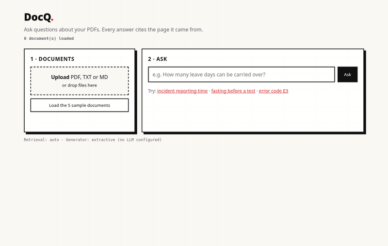
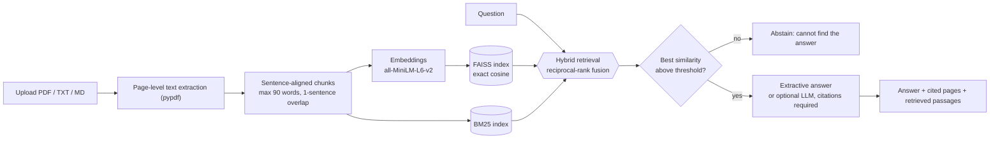
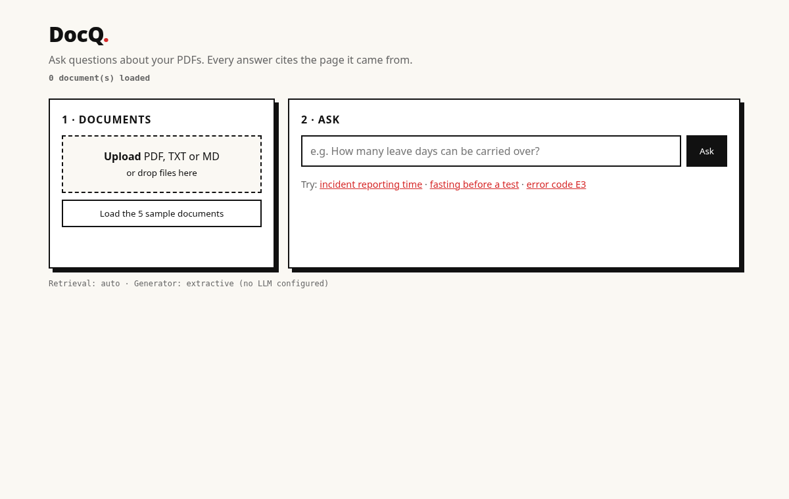
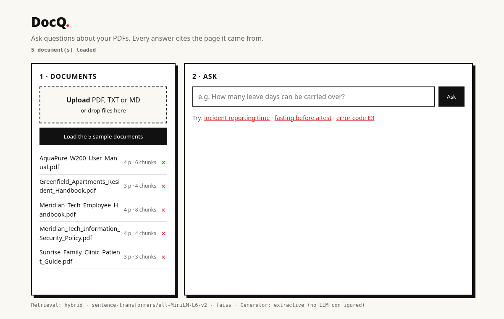
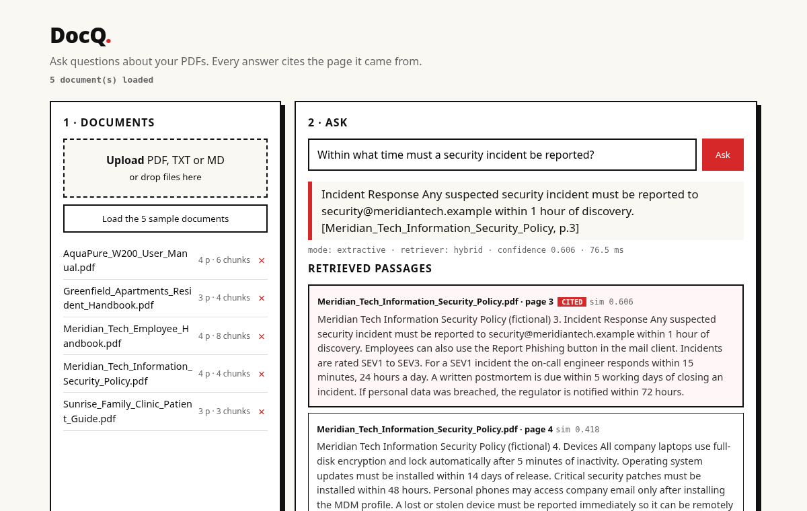
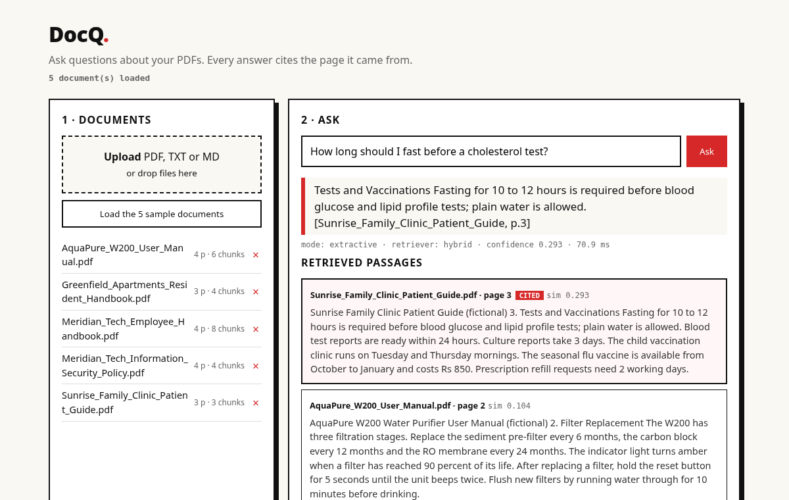
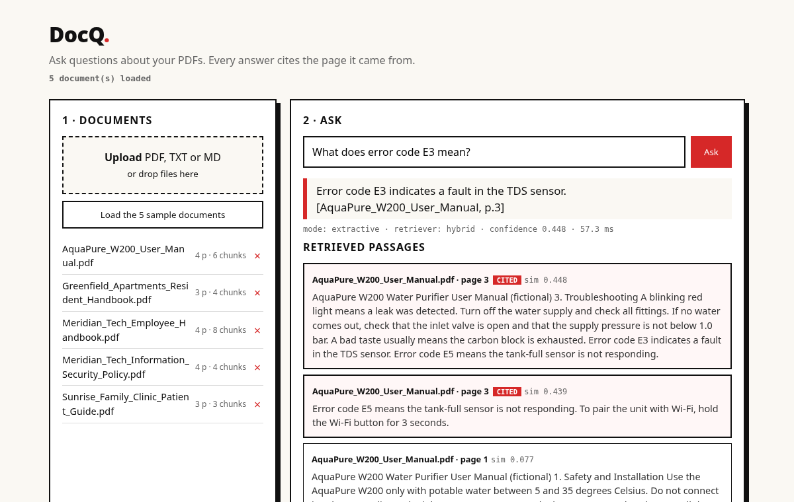

# DocQ

### Document Q&A with retrieval-augmented generation and page-level citations


DocQ lets you upload PDFs or text files, ask a question in plain language, and get an answer **with page-level citations**, with the retrieved passages shown next to it. It runs fully locally and free: no API key is needed.



---

## ✨ Key features

- **Cited answers.** Every answer sentence is tagged `[document, p.N]`, and PDFs are read page by page, so a citation is a real PDF page number.
- **Hybrid retrieval.** Dense search (MiniLM embeddings with FAISS) and BM25 are combined with reciprocal-rank fusion. `dense`, `bm25` and `hybrid` modes are all available.
- **Transparent sources.** The retrieved passages are listed with similarity scores, and the cited passage is highlighted.
- **Abstention.** If the best cosine similarity is below `DOCQ_MIN_SCORE` (0.25), DocQ says it cannot find the answer. See the evaluation and Limitations for how well this works.
- **Extractive by default.** Answers are sentences copied from the source pages, so no generative model is involved unless you configure one.
- **Optional LLM step.** Any OpenAI-compatible `/chat/completions` endpoint (OpenAI, Ollama, llama.cpp, vLLM and others) can be used. The model only sees the retrieved passages and must cite `[n]`. If it fails, DocQ falls back to extractive answers.
- **Reproducible evaluation.** A labelled question set and a script (`eval/run_eval.py`) regenerate the numbers below.

---

## 🏗️ How it works



---

## 📷 Screenshots

### 1. Empty workspace


### 2. Sample documents loaded


### 3. Cited answer: security incident reporting


### 4. Cited answer: fasting before a test


### 5. Cited answer: error code lookup


---

## 📊 Evaluation (measured, reproducible: `python eval/run_eval.py`)

**Measured on my test set of 25 answerable questions** (+ 5 out-of-scope questions), over **5 fictional documents / 18 pages**
that I wrote myself (`sample_docs/`, regenerated by `scripts/make_sample_docs.py`). Gold label for each question = the
exact document + page that contains the answer, plus a key fact the answer must contain.
The abstention threshold was picked on a *separate* 8-question dev set (`eval/dev_questions.json`), not on the test set.

| retriever | hit@1 | hit@3 | hit@5 | MRR | answer cites the gold page | answer contains the key fact |
|---|---|---|---|---|---|---|
| BM25 only | 0.84 | 0.92 | 0.96 | 0.90 | 0.80 | 0.60 |
| MiniLM + FAISS (dense) | 0.92 (23/25) | 0.96 (24/25) | 1.00 (25/25) | 0.95 | 0.96 (24/25) | 0.92 (23/25) |
| **hybrid (default)** | 0.92 | 0.96 | 1.00 | 0.94 | 0.96 | 0.92 |

hit@k / MRR are at *page* level (is the gold page among the top-k distinct pages). Median end-to-end `ask` latency on a CPU-only
8-core box: ~60 ms (dense/hybrid), <1 ms (BM25). Full per-question output: `eval/results.json`, table: `eval/RESULTS.md`.

Failures (kept in, not hidden):
- "How soon will someone come if my flat floods?" — retrieval ranked the right page 5th; the answer cited the wrong document (warranty page).
- "How many leave days can be carried over…" — right page cited, but the extractive sentence picker chose "Sick leave is 12 days…" instead of the carry-forward sentence.
- **Out-of-scope questions are mostly NOT rejected**: the dense/hybrid abstention caught only 1 of 5 (questions that are on-topic but absent, like "How many floors does the building have?", still score a similarity above the threshold). BM25's stricter rule caught 4/5 but wrongly refused 16% of valid questions. A real system needs an LLM or a reranker/NLI check for this.

---

## 🧩 Tech stack

| Piece | What it is |
|---|---|
| Backend | FastAPI (`docq/api.py`) |
| PDF text | `pypdf`, page by page (so a citation is a real PDF page number) |
| Chunking | sentence-aligned chunks of ≤ 90 words, 1-sentence overlap, never crossing a page |
| Embeddings | **`sentence-transformers/all-MiniLM-L6-v2`** (384-dim, runs on CPU), with a file-name context header on each chunk |
| Vector search | **FAISS** `IndexFlatIP` (exact cosine search); falls back to numpy if FAISS is missing |
| Sparse search | own BM25 implementation (no dependency) |
| Retrieval modes | `dense`, `bm25`, `hybrid` (reciprocal-rank fusion). `auto` = hybrid, or BM25 only if `sentence-transformers` is not installed |
| Answering (default) | **Extractive**: the best 1–2 sentences from the top retrieved chunks, each tagged `[document, p.N]`. No generative model is involved by default |
| Answering (optional LLM) | Set `DOCQ_LLM_BASE_URL` + `DOCQ_LLM_MODEL` (+ `DOCQ_LLM_API_KEY`) for any OpenAI-compatible `/chat/completions` endpoint (OpenAI, Ollama, llama.cpp, vLLM…). The LLM only sees the retrieved passages and must cite `[n]`; if it fails, DocQ falls back to extractive |
| Abstention | If the best cosine similarity is below `DOCQ_MIN_SCORE` (0.25) it says it cannot find the answer |
| Frontend | plain HTML/CSS/JS in `frontend/` (upload, ask, cited sources) |

**Honesty notes:** the LLM path is covered by tests with a *mocked* endpoint only. I have **not** run it against a real model, so no quality numbers exist for it. All numbers above are for the extractive mode.

---

## 📂 Project structure

```text
docq/
├── docq/
│   ├── api.py            # FastAPI app and routes
│   ├── service.py        # document store and ask pipeline
│   ├── ingest.py         # PDF/text extraction and chunking
│   ├── retrieval.py      # BM25, dense (FAISS) and hybrid retrieval
│   ├── answer.py         # extractive answering and abstention
│   ├── llm.py            # optional OpenAI-compatible generation
│   └── config.py         # configuration from environment variables
├── frontend/             # plain HTML/CSS/JS interface
├── sample_docs/          # 5 fictional PDFs used by the demo and evaluation
├── eval/                 # question sets, run_eval.py, results.json, RESULTS.md
├── scripts/
│   └── make_sample_docs.py
├── tests/                # pytest suite
├── docs/                 # screenshots and demo GIF
├── Dockerfile
├── requirements.txt
└── requirements-dev.txt
```

---

## 🚀 Getting started

```bash
python -m venv .venv && source .venv/bin/activate
pip install -r requirements.txt          # downloads CPU torch + the ~90 MB MiniLM model on first use
uvicorn docq.api:app --port 8000          # open http://localhost:8000 and press "Load the 5 sample documents"
```

Optional LLM generation (example: local Ollama):

```bash
export DOCQ_LLM_BASE_URL=http://localhost:11434/v1 DOCQ_LLM_MODEL=llama3.1:8b
```

Docker: `docker build -t docq . && docker run -p 8000:8000 docq`
(the Dockerfile is written but **I could not build it here, Docker is not installed on my machine**, so it is untested).

API: `GET /api/health`, `GET/POST /api/documents`, `DELETE /api/documents/{name}`, `POST /api/load-samples`, `POST /api/ask {"question": "..."}`.

---

## 🧪 Tests

```bash
pip install -r requirements-dev.txt && python -m pytest -q
```

The 17 tests cover PDF pages, chunking (including BOM and run-on text), BM25, dense and hybrid retrieval, the fallback path, extractive answers, abstention, the mocked LLM path and the API.

---

## ⚠️ Limitations

- Small, author-written, fairly clean corpus and questions written by the same author: expect lower numbers on real, messy documents. 25 questions is too few for tight confidence intervals (one question = 4 points).
- Extractive answers are sentences copied from the page, not synthesised; multi-sentence reasoning needs the optional LLM step.
- Page headings are merged into the first sentence of a page (PDF layout isn't parsed), which looks untidy in answers.
- No OCR (scanned PDFs are rejected), no tables, in-memory index (lost on restart), no auth, no multi-user isolation.

